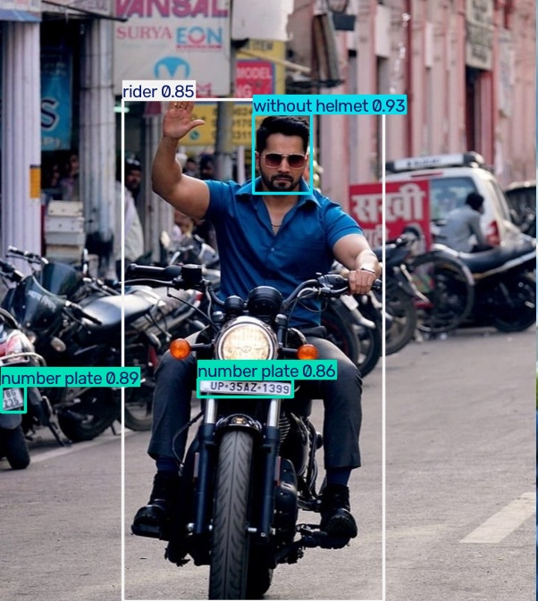
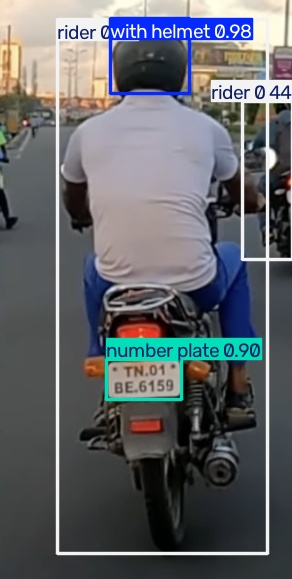
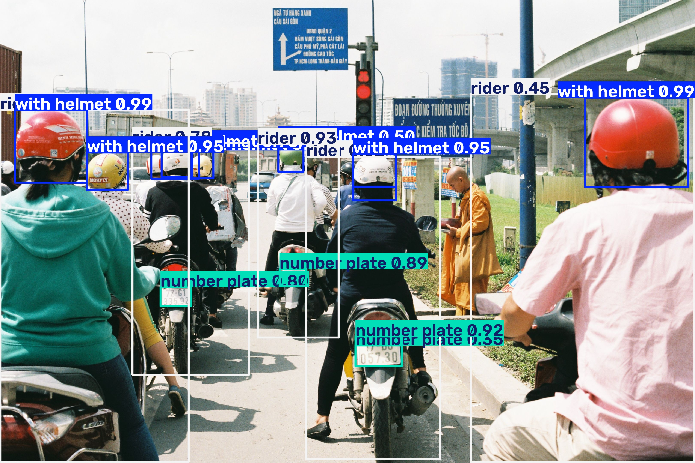

# Helmet and Number Plate Detection using YOLOv8

Detects motorcycle riders with and without helmets and finds number plates in images, using a YOLOv8 model trained on the Rider With / Without Helmet, Number Plate dataset (Kaggle, aneesarom).

## Run

    pip install ultralytics
    yolo detect predict model=weights/best.pt source=input save=True

Results are saved in runs/detect/.

## Results

## Credit

Based on the repository by priyadarshpv.
